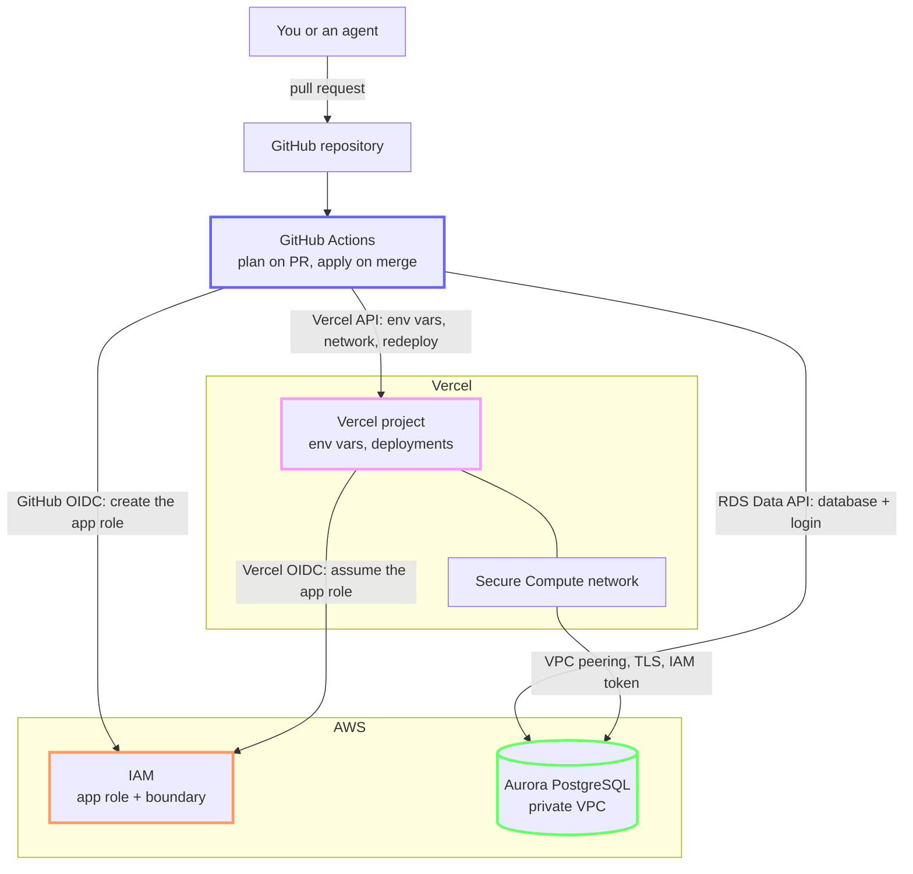
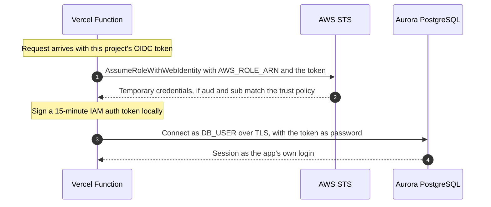

# Postgres for Vercel apps, one pull request at a time

This repository gives any Vercel project its own Postgres database, or read-only access to a shared one, when you merge a pull request. A few minutes after the merge, the app is redeployed, reaches the database over a private network, and signs in with an IAM token that expires after 15 minutes. The app never gets a database password, because none exists.

```hcl
module "expense_tracker" {
  source   = "../modules/app-database"
  platform = local.platform

  vercel_project = "expense-tracker"
  database       = "expense_tracker"
  access         = "owner"
}
```

That block in `apps/apps.tf` is the whole request. Terraform, GitHub Actions, AWS IAM, Aurora and the Vercel API do the rest.

## Why you'd want it

Connecting an internal app to a database often means a ticket, a shared password pasted into environment variables, and a firewall rule that outlives the app.

| | Common setup | This pipeline |
|---|---|---|
| Asking for a database | Ticket to the platform team | Pull request, applied a few minutes after merge |
| App credentials | Long-lived password in env vars | IAM token signed at runtime, valid for 15 minutes |
| Who can use them | Anyone who copies the password | Only this project's production and preview deployments |
| Network path | Public endpoint or IP allowlist | Secure Compute network, peered with the database VPC |
| CI access to AWS | Access keys stored as CI secrets | GitHub OIDC, no AWS keys stored anywhere |
| Audit trail | Ticket comments | Git history, with the Terraform plan on every pull request |
| Removing an app | Manual cleanup, often skipped | Delete the block: database, login, role, env vars and network link go with it |

It suits platform teams that run internal tools and AI agents on Vercel and keep their data in AWS. Because a request is a small code change with a predictable plan, an agent can file one too, and it goes through the same plan and review. The repository includes a Claude Code skill for that.

## How it fits together



Requests flow down through GitHub Actions, which sets up both sides. At runtime the app talks to AWS directly: it trades its Vercel OIDC token for the app role, then connects to Aurora through the Secure Compute network.

## Life of a request

```
1. Pull request   add a module block to apps/apps.tf
2. Plan           Actions runs terraform plan with a read-only AWS role and posts it as a comment
3. Review         one new app plans exactly "Plan: 11 to add, 0 to change, 0 to destroy."
4. Merge, apply   Actions applies with the apply role: database, IAM role, env vars, network, redeploy
5. Live           the redeployed app can sign in to its database
```

The plan takes under a minute. The apply takes a few minutes, most of it waiting for the production redeploy.

For read-only access to an existing database, use `access = "read"` and the database's name, for example `database = "hr_reporting"`.

## What one app gets

Each module call creates 11 resources:

| Resource | What it does |
|---|---|
| `terraform_data.database` | Creates the Postgres login `app_<project>` through the RDS Data API and, for `owner` access, a new database |
| `aws_iam_role.app` | The role `vercel-app-<project>`, which only this project's Vercel OIDC tokens can assume. The permissions boundary caps it. |
| `aws_iam_role_policy.db_connect` | Allows `rds-db:connect` as `app_<project>`, and nothing else |
| 6 × `vercel_project_environment_variable.app` | `AWS_ROLE_ARN`, `DB_HOST`, `DB_NAME`, `DB_USER`, `DB_REGION` and `DB_ACCESS` for production and preview. None of them is a secret. |
| `terraform_data.network` | Runs the project's functions on the Secure Compute network |
| `terraform_data.redeploy` | Redeploys production and waits until the new deployment is ready |

`DB_HOST` is the cluster's writer endpoint for `owner` access and its reader endpoint for `read` access.

## How the app connects



In Python, with `boto3`, `psycopg` and Vercel's `vercel-oidc` package:

```python
import os

import boto3
import psycopg
from vercel.oidc.aio import get_vercel_oidc_token

# Vercel sends the OIDC token with each request. Add a middleware that calls
# vercel.headers.set_headers(request.headers) so the SDK can read it.


async def connect():
    region = os.environ["DB_REGION"]

    # 1. Trade the Vercel OIDC token for temporary credentials of the app role.
    credentials = boto3.client("sts", region_name=region).assume_role_with_web_identity(
        RoleArn=os.environ["AWS_ROLE_ARN"],
        RoleSessionName="vercel-app",
        WebIdentityToken=await get_vercel_oidc_token(),
    )["Credentials"]

    # 2. Sign a database token. This happens locally, with no network call.
    rds = boto3.client(
        "rds",
        region_name=region,
        aws_access_key_id=credentials["AccessKeyId"],
        aws_secret_access_key=credentials["SecretAccessKey"],
        aws_session_token=credentials["SessionToken"],
    )
    token = rds.generate_db_auth_token(
        DBHostname=os.environ["DB_HOST"], Port=5432, DBUsername=os.environ["DB_USER"], Region=region
    )

    # 3. Connect. Aurora accepts IAM tokens only over TLS. Use sslmode="verify-full"
    #    with the RDS CA bundle to verify the server certificate as well.
    return psycopg.connect(
        host=os.environ["DB_HOST"],
        dbname=os.environ["DB_NAME"],
        user=os.environ["DB_USER"],
        password=token,
        sslmode="require",
    )
```

In Node.js, `awsCredentialsProvider` from `@vercel/oidc-aws-credentials-provider` handles step 1, and `Signer` from `@aws-sdk/rds-signer` handles step 2.

## The concepts behind it

### Pull requests are the request form

Every change to the platform is a commit to `apps/apps.tf`. On a pull request, the `plan` job checks formatting with `terraform fmt -check`, runs `terraform plan`, and posts the result as a comment. On later pushes it edits its own comment, so the pull request always shows the current plan. A merge to `main` triggers the `apply` job. A shared concurrency group runs one Terraform job at a time, and the S3 backend locks state with a lock file in the bucket, so there's no DynamoDB lock table. All actions are pinned to commit SHAs.

One new app always plans 11 additions, so a reviewer or an agent can spot an unexpected change before anything is applied.

### No passwords: IAM database authentication

Each app's Postgres login is created without a password and granted the `rds_iam` role, which makes Aurora accept only [IAM authentication tokens](https://docs.aws.amazon.com/AmazonRDS/latest/AuroraUserGuide/UsingWithRDS.IAMDBAuth.html) for it. A token is a signed request that the app creates locally from its AWS credentials. It's valid for new connections for 15 minutes and only works over TLS. A leaked token stops working within 15 minutes and only ever opens one app's login, so there's nothing to rotate.

### Workload identity on both sides

Nothing in this system has a static AWS credential. It uses OIDC federation in two places.

The app gets its AWS role through [Vercel OIDC federation](https://vercel.com/docs/oidc/aws). Vercel issues each deployment a short-lived token, and the role's trust policy only accepts tokens for one project in specific environments:

```json
"Condition": {
  "StringEquals": {
    "oidc.vercel.com/<team>:aud": "https://vercel.com/<team>",
    "oidc.vercel.com/<team>:sub": [
      "owner:<team>:project:expense-tracker:environment:production",
      "owner:<team>:project:expense-tracker:environment:preview"
    ]
  }
}
```

Another project in the same team can't assume this role, and neither can a development token pulled to a laptop. The module checks that the project uses the Team issuer mode, which these claims expect, and stops the plan with a clear error if it doesn't.

The pipeline gets its AWS roles through [GitHub's OIDC provider](https://docs.github.com/en/actions/concepts/security/openid-connect). The plan role trusts only pull request runs, and the apply role trusts only runs on `main`. Both match GitHub's immutable subject format, `repo:<owner>@<owner-id>/<repo>@<repo-id>`, which includes numeric IDs. A renamed repository, or a new one created under the old name, can't inherit the trust.

### A permissions boundary caps every app role

Every role the pipeline creates must carry the `vercel-app-boundary` [permissions boundary](https://docs.aws.amazon.com/IAM/latest/UserGuide/access_policies_boundaries.html). A boundary sets the most a role can ever do, whatever its own policies say. This one allows exactly one thing:

```hcl
Effect   = "Allow"
Action   = "rds-db:connect"
Resource = "arn:aws:rds-db:<region>:<account>:dbuser:<cluster-resource-id>/app_*"
```

The apply role enforces it. It can only create roles named `vercel-app-*`, and only when the request attaches this boundary. An explicit deny stops it from removing or replacing a boundary later. Whatever a module call says, an app role can't get beyond "sign in to the shared cluster as an `app_*` user".

### Isolation inside Postgres

Each app gets its own login on the shared cluster, with guardrails so one app can't starve the others. In effect, the pipeline runs:

```sql
CREATE ROLE app_expense_tracker LOGIN;   -- no password
GRANT rds_iam TO app_expense_tracker;    -- IAM tokens only
ALTER ROLE app_expense_tracker CONNECTION LIMIT 10;
ALTER ROLE app_expense_tracker SET statement_timeout = '30s';
```

With `owner` access, the app also gets a new database. Public access to it is revoked, and only the app's login may connect, create temporary tables, and create objects in the `public` schema. Other apps on the cluster can't connect to it at all.

### Shared data through access profiles

With `read` access, the app attaches to a database that a data owner published. Publishing means creating a `NOLOGIN` role named `<database>_read` that grants exactly what apps may see. The pipeline grants that role to the app's login, so the app sees what the profile sees. It refuses to attach a database that has no such profile.

`hr_reporting` shows the pattern with generated data. Its raw table holds a sensitive column, `salary_band`. The `hr_reporting_read` profile can read only the views in the `reporting` schema, which aggregate headcount and leave that column out. Attaching `hr_reporting` is self-service. Any other read access should wait for the data owner's approval on the pull request.

### SQL without a network path: the RDS Data API

The database sits in a private VPC, and GitHub-hosted runners have no route into it. The pipeline runs its SQL through the [RDS Data API](https://docs.aws.amazon.com/AmazonRDS/latest/AuroraUserGuide/data-api.html), an HTTPS API, so there's no bastion host, VPN, or self-hosted runner. It authenticates with the cluster's RDS-managed master secret in Secrets Manager, so no person ever sees that password. If the cluster is paused, the script waits and retries while it resumes.

### Private networking with Secure Compute

[Secure Compute](https://vercel.com/docs/networking/secure-compute) gives a Vercel team a dedicated network that's peered with your VPC. The module links the project's production and preview functions to that network through the Vercel REST API. Builds stay off it, because a build doesn't need the database. The database needs no public endpoint and no allowlist of Vercel IP ranges.

### Redeploying so changes take effect

Environment variables and the network link only apply to new deployments. The module redeploys the project's current production deployment and waits up to 10 minutes for it to be ready. A project without a production deployment yet picks up everything with its first deploy. A later change to the database, network, policy or env var values triggers a redeploy again.

### Removing an app cleanly

To remove an app, delete its module call. Terraform has a catch here: [destroy-time provisioners don't run](https://developer.hashicorp.com/terraform/language/provisioners) when their resource block is removed from the configuration, and removing a module call does exactly that. Without a workaround, the database and network link would outlive the app.

The apply job works around it. It saves the plan, and `cleanup_removed.py` reads it as JSON. For each app the plan deletes, it runs the same drop and unlink steps the provisioners would have run, with the values Terraform stored in state. Then Terraform applies the plan. That's also why the provisioners read everything from `self.input`: the values have to survive in state after the configuration is gone.

### Agents use the same path

`.claude/skills/provision-app-database/` teaches Claude Code, or the Claude desktop app with the GitHub connector, to file requests. It asks for the project and the database, opens the pull request, waits for the plan, and checks for exactly 11 additions. It merges only self-service requests, then follows the apply and checks the live app. The skill never runs Terraform and never touches AWS, so the agent's requests go through the same plan, review and audit trail as everyone else's.

## Repository layout

| Path | Applied by | Purpose |
|---|---|---|
| `bootstrap/` | A platform admin, once, locally | State bucket, GitHub OIDC roles, the app role boundary, and the attachable `hr_reporting` database |
| `apps/` | GitHub Actions | One module call per app, plus `platform.tf`, which looks up the shared platform |
| `modules/app-database/` | | The per-app module and its helper scripts (standard library Python and the AWS CLI) |
| `sql/hr_reporting.sql` | `bootstrap/` | Schema, generated data and the `hr_reporting_read` profile |
| `.claude/skills/provision-app-database/` | | The agent skill |

## Prerequisites

The pipeline plugs into a platform that already exists:

- A Vercel team with a [Secure Compute](https://vercel.com/docs/networking/secure-compute) network peered with an AWS VPC. Secure Compute is available for purchase on Enterprise plans.
- An Aurora PostgreSQL cluster in that VPC, with IAM database authentication, the RDS Data API, and an RDS-managed master secret.
- An IAM OIDC provider for your team's Vercel issuer, `https://oidc.vercel.com/<team>`. App projects use the Team issuer mode.
- On the admin's machine, for the one-time bootstrap: Terraform 1.10 or later, Python 3.9 or later, and the AWS CLI. The workflow installs its own Terraform.

## Setup

1. Copy `bootstrap/terraform.tfvars.example` to `bootstrap/terraform.tfvars`, fill it in, and apply `bootstrap/` once with admin credentials.
2. Set the repository variables from the `github_variables` output, plus `VERCEL_NETWORK_ID`, with `gh variable set NAME --body VALUE`.
3. Add a Vercel access token scoped to the team as the `VERCEL_API_TOKEN` repository secret.
4. Protect `main` with required reviews. A merge runs with the apply role.
5. In `.claude/skills/provision-app-database/SKILL.md`, replace `<owner>/<repo>` and `<team>` with your values.

Keep your working copy private. Plan comments and workflow logs include your AWS account ID, resource ARNs and Vercel project IDs.

## Limits and trade-offs

- One project gets one database login. Its name comes from the project name, so the project name has at most 52 characters.
- Only production and preview get access. Local development doesn't, so use a separate database for it.
- Apps share the cluster's compute. Connection limits and statement timeouts keep one app from starving the others, but they don't give each app dedicated capacity.
- The apply role can run SQL as the master user through the Data API, because creating databases and logins needs it. Treat merges to `main` as privileged.
- One secret is stored: the team-scoped `VERCEL_API_TOKEN`.
- The skill verifies a connection by fetching `https://<project>.vercel.app/api/db`. Give your app that endpoint, or adapt the last step of the skill.
