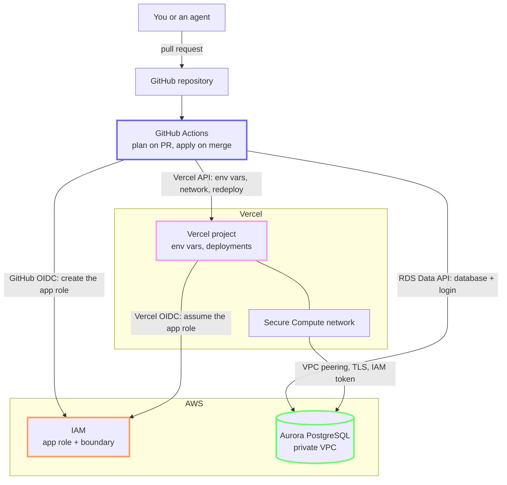
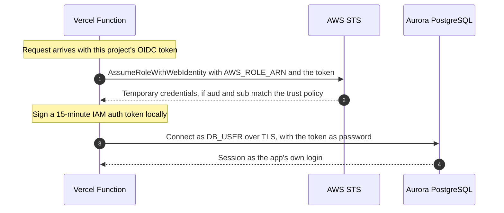

# Non-public databases, one pull request at a time

This repository gives any Vercel project its own Postgres database, or read-only access to a shared one, when you merge a pull request. A few minutes after the merge, the app is redeployed, reaches the database over a private network, and signs in with an IAM token that expires after 15 minutes. The app never gets a database password, because none exists.

```hcl
module "my_application" {
  source   = "../modules/app-database"
  platform = local.platform

  vercel_project = "my-application"
  database       = "my_application"
  access         = "owner"
}
```

That block in `apps/apps.tf` is the whole request. Terraform, GitHub Actions, AWS IAM, Aurora and the Vercel API do the rest.

## Why you'd want it

Connecting an internal app to a database often means a ticket, a shared password pasted into environment variables, and a firewall rule that outlives the app.

| | ❌ Common setup | ✅ This pipeline |
|---|---|---|
| Asking for a database | Ticket to the platform team | Pull request, applied a few minutes after merge |
| App credentials | Long-lived password in env vars | IAM token signed at runtime, valid for 15 minutes |
| Who can use them | Anyone who copies the password | Only this project's production and preview deployments |
| Network path | Public endpoint or IP allowlist | Secure Compute network, peered with the database VPC |
| CI access to AWS | Access keys stored as CI secrets | GitHub OIDC, no AWS keys stored anywhere |
| Audit trail | Ticket comments | Git history, with the Terraform plan on every pull request |
| Removing an app | Manual cleanup, often skipped | Delete the block: database, login, role, env vars and network link go with it |

It suits platform teams that run internal tools and AI agents on Vercel and keep their data in AWS. Because a request is a small code change with a predictable plan, an agent can file one too, and it goes through the same plan and review. The repository includes a Claude Code skill for that.

## How it fits together



Requests flow down through GitHub Actions, which sets up both sides. At runtime the app talks to AWS directly: it trades its Vercel OIDC token for the app role, then connects to Aurora through the Secure Compute network.

## Life of a request

```
1. Pull request   add a module block to apps/apps.tf
2. Plan           Actions runs terraform plan with a read-only AWS role and posts it as a comment
3. Review         one new app plans exactly "Plan: 11 to add, 0 to change, 0 to destroy."
4. Merge, apply   Actions applies with the apply role: database, IAM role, env vars, network, redeploy
5. Live           the redeployed app can sign in to its database
```

The plan takes under a minute. The apply takes a few minutes, most of it waiting for the production redeploy.

For read-only access to an existing database, use `access = "read"` and the database's name, for example `database = "hr_reporting"`.

## What one app gets

Each module call creates 11 resources:

| Resource | What it does |
|---|---|
| `terraform_data.database` | Creates the Postgres login `app_<project>` through the RDS Data API and, for `owner` access, a new database |
| `aws_iam_role.app` | The role `vercel-app-<project>`, which only this project's Vercel OIDC tokens can assume. The permissions boundary caps it. |
| `aws_iam_role_policy.db_connect` | Allows `rds-db:connect` as `app_<project>`, and nothing else |
| 6 × `vercel_project_environment_variable.app` | `AWS_ROLE_ARN`, `DB_HOST`, `DB_NAME`, `DB_USER`, `DB_REGION` and `DB_ACCESS` for production and preview. None of them is a secret. |
| `terraform_data.network` | Runs the project's functions on the Secure Compute network |
| `terraform_data.redeploy` | Redeploys production and waits until the new deployment is ready |

`DB_HOST` is the cluster's writer endpoint for `owner` access and its reader endpoint for `read` access.

## How the app connects



In Python, with `boto3`, `psycopg` and Vercel's `vercel-oidc` package:

```python
import os

import boto3
import psycopg
from vercel.oidc.aio import get_vercel_oidc_token

# Vercel sends the OIDC token with each request. Add a middleware that calls
# vercel.headers.set_headers(request.headers) so the SDK can read it.


async def connect():
    region = os.environ["DB_REGION"]

    # 1. Trade the Vercel OIDC token for temporary credentials of the app role.
    credentials = boto3.client("sts", region_name=region).assume_role_with_web_identity(
        RoleArn=os.environ["AWS_ROLE_ARN"],
        RoleSessionName="vercel-app",
        WebIdentityToken=await get_vercel_oidc_token(),
    )["Credentials"]

    # 2. Sign a database token. This happens locally, with no network call.
    rds = boto3.client(
        "rds",
        region_name=region,
        aws_access_key_id=credentials["AccessKeyId"],
        aws_secret_access_key=credentials["SecretAccessKey"],
        aws_session_token=credentials["SessionToken"],
    )
    token = rds.generate_db_auth_token(
        DBHostname=os.environ["DB_HOST"], Port=5432, DBUsername=os.environ["DB_USER"], Region=region
    )

    # 3. Connect. Aurora accepts IAM tokens only over TLS. Use sslmode="verify-full"
    #    with the RDS CA bundle to verify the server certificate as well.
    return psycopg.connect(
        host=os.environ["DB_HOST"],
        dbname=os.environ["DB_NAME"],
        user=os.environ["DB_USER"],
        password=token,
        sslmode="require",
    )
```

> [!IMPORTANT]
> Keep your working copy private. Plan comments and workflow logs include your AWS account ID, resource ARNs and Vercel project IDs.
